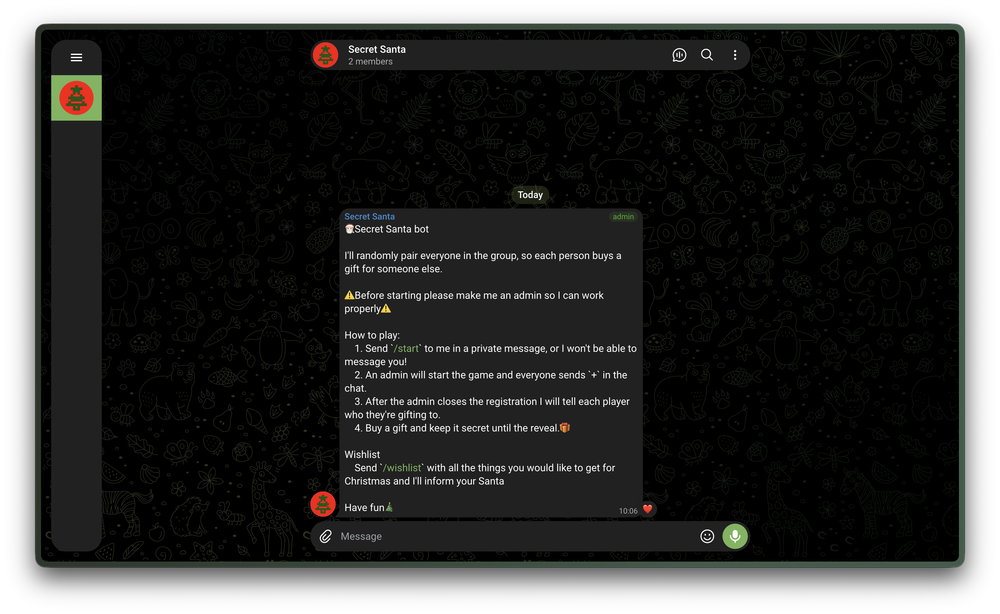

<div align="center">

# Secret Santa Bot

</div>

---

A simple Telegram bot to play Secret Santa with friends. Automatic pair choosing wishlists and 2 languages right of the box.

Demo: [Secret Santa Bot](https://t.me/secret_santar_bot)

## Tech Stack

---

| Layer | Technology| 
| --- | --- |
| Programming language| Rust|
| Telegram Bot API| [Teloxide](https://github.com/teloxide/teloxide)|
| Database| SQLite and [SeaOrm](https://www.sea-ql.org/SeaORM/)|
| Internationalization | Custom simple translator|

## Getting started

---

#### First clone the repository

```sh
git clone https://github.com/gev-hobosyan/secret_santa 
&& cd secret_santa
```

#### Get your bot token

1. Go to [BotFather](https://t.me/BotFather)
2. Register a bot
3. Copy the token

#### Add your bot token to the environment

```sh
export TELOXIDE_TOKEN="your_token"
```

### Development

```sh
cargo run
```

### Production
```sh
cargo build --release && ./target/release/secret_santa
```

## Screenshots

---

